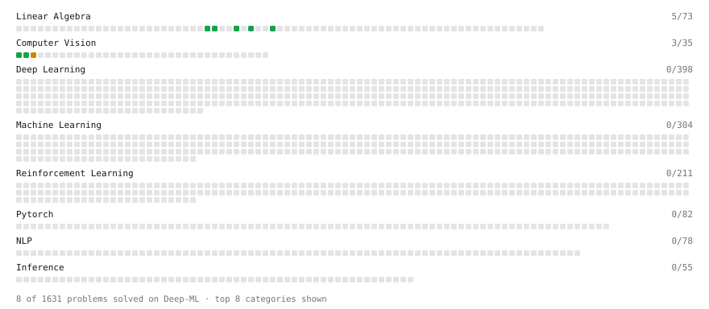

# Deep-ML

My machine learning practice from [Deep-ML](https://www.deep-ml.com). Every solution here was written by hand.

**7** solved · 5 problems · 0 labs · 2 math

[**Browse the interactive portfolio**](https://SamuelWLee27.github.io/deep-ml/) to replay this filling in over time.

## Problems

| | Difficulty | Solved | |
| --- | --- | --- | --- |
| [Calculate Image Brightness](https://www.deep-ml.com/problems/70) | easy | 2026-10-15 | [solution](problems/0070-calculate-image-brightness) |
| [Dot Product Calculator](https://www.deep-ml.com/problems/83) | easy | 2026-10-22 | [solution](problems/0083-dot-product-calculator) |
| [Grayscale Image Contrast Calculator](https://www.deep-ml.com/problems/82) | easy | 2026-10-15 | [solution](problems/0082-grayscale-image-contrast-calculator) |
| [Vector Element-wise Sum](https://www.deep-ml.com/problems/121) | easy | 2026-10-22 | [solution](problems/0121-vector-element-wise-sum) |
| [Optical Flow EPE with Masks (OmniWorld-style metric)](https://www.deep-ml.com/problems/185) | medium | 2026-10-15 | [solution](problems/0185-optical-flow-epe-with-masks-omniworld-style-metric) |

## Math

| | Difficulty | Solved | |
| --- | --- | --- | --- |
| [Vector Operations](https://www.deep-ml.com/math-problems/7) | easy | 2026-10-22 | [solution](math/0007-vector-operations) |
| [Vector Norms and Linear Independence](https://www.deep-ml.com/math-problems/8) | medium | 2026-10-22 | [solution](math/0008-vector-norms-and-linear-independence) |

---

_This file is regenerated by Deep-ML on every push._
